<div align="center">

<picture>
  <source media="(prefers-color-scheme: dark)" srcset="docs/logo-ciemne.png">
  
</picture>

### Od ukrytego pomysłu do wdrożenia w kolejnej instytucji

Platforma, która **odnajduje, ocenia i łączy** innowacje ze szkół, uczelni, samorządów i instytucji publicznych.<br>
Rozwiązanie wyzwania *„Radar Innowacji”* Podkarpackiego Centrum Innowacji · **HackNation 2026**

[](https://radarinnowacji.pl)
[](https://www.youtube.com/watch?v=vYtciX8sH9E)


[Problem](#-problem) · [Rozwiązanie](#-rozwiązanie) · [Wymagania wyzwania](#-wymagania-wyzwania--co-dokładnie-robi-platforma) · [Zrzuty ekranu](#-jak-to-wygląda) · [Metoda oceny](#-metoda-oceny) · [Uruchomienie](#-uruchomienie-lokalne-ok-5-minut) · [Scenariusz dla jury](#-scenariusz-dla-jury-ae)

<br>

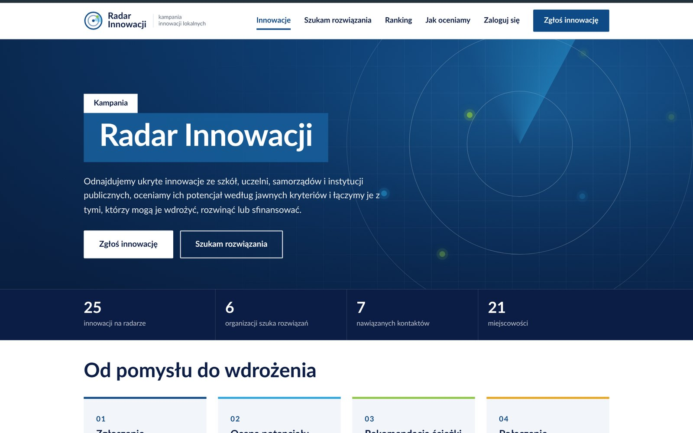

</div>

---

## ⚡ W 30 sekund

> Gmina z Podkarpacia wymyśla SMS-owe zgłaszanie usterek dla seniorów. Działa świetnie – i na tym się kończy, bo nikt poza gminą o tym nie wie.
> **Radar Innowacji** zbiera takie rozwiązania w jednym miejscu, **ocenia ich potencjał według jawnych kryteriów**, **podpowiada, co z nimi zrobić dalej** (transfer, komercjalizacja, pilotaż, ochrona IP, finansowanie) i **łączy je z instytucjami, które szukają dokładnie takiego rozwiązania**.

| 🏛️ 25 | 🧭 7 | 🛤️ 5 | 🔗 2 strony |
|:---:|:---:|:---:|:---:|
| przykładowych innowacji w danych demo | jawnych kryteriów oceny z wagami | ścieżek rozwoju z krokami i miernikami | dopasowania: innowacja ↔ potrzeba |

---

## 🧩 Problem

Wartościowe innowacje powstają w szkołach, uczelniach, samorządach i instytucjach publicznych, ale zwykle **zostają w organizacji, w której powstały**. Brakuje prostego mechanizmu, który pozwala je odnajdywać, porównywać ich potencjał i kierować do odbiorców. Przez to różne instytucje **rozwiązują te same problemy od zera**.

## 💡 Rozwiązanie

Platforma prowadzi innowację przez cały proces:

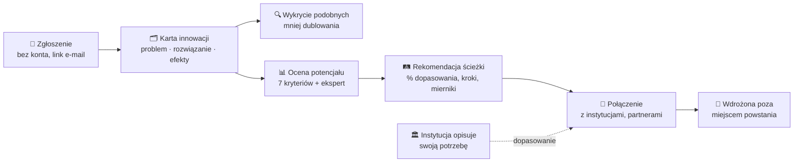

| Funkcja | Opis |
|---|---|
| 🗂️ **Karta innowacji** | Uporządkowane informacje: problem, rozwiązanie, efekty, etap, skala, koszt transferu, obszary, potrzeby twórców. Także innowacje organizacyjne, edukacyjne i społeczne – nie tylko technologiczne. |
| 🔍 **Podpowiedź podobnych** | Już podczas wypełniania formularza system pokazuje podobne innowacje z bazy (TF-IDF + podobieństwo cosinusowe) – mniej dublowania prac. |
| 📊 **Ocena potencjału** | 7 jawnych kryteriów z wagami. Ocena wstępna automatyczna, z uzasadnieniem każdej liczby; eksperci mogą ją skorygować. |
| 🛤️ **Rekomendacja ścieżki** | Transfer, komercjalizacja, rozwój i pilotaż, ochrona IP, finansowanie – z % dopasowania, uzasadnieniem, krokami, **miernikami skuteczności** i źródłami wsparcia. |
| 🤝 **Łączenie** | Organizacje opisują, czego szukają; system dopasowuje innowacje w obie strony. Dopasowania są **niepubliczne** – widzą je tylko zainteresowane strony. Kontakt bez ujawniania adresów e-mail. |
| 🚦 **Etapy procesu** | Zgłoszona → W ocenie → Oceniona → Łączenie → Wdrażanie → **Wdrożona poza miejscem powstania**. |
| 🌍 **Bazy zewnętrzne** | Słowa kluczowe i gotowe linki do UPRP, EPO, Google Patents, PBN, Interreg, NCBR. |
| 🛡️ **Bezpieczeństwo** | Logowanie linkiem e-mail (bez haseł), CSRF, CSP, IP tylko jako HMAC (RODO), wielowarstwowa ochrona głosowania przed botami. |
| 🧑‍⚖️ **Panel moderatora** | Moderacja, ocena ekspercka, usuwanie, weryfikacja podejrzanych głosów, dziennik działań, eksport CSV, dane demonstracyjne jednym kliknięciem. |

---

## ✅ Wymagania wyzwania → co dokładnie robi platforma

| Wymaganie z wyzwania | Gdzie to jest | Status |
|---|---|:---:|
| **a)** Wprowadzenie innowacji | `/zglos` – formularz bez zakładania konta, logowanie jednorazowym linkiem | ✅ |
| **b)** Uporządkowanie informacji | Karta innowacji: problem, rozwiązanie, efekty, parametry porównywalne między zgłoszeniami | ✅ |
| **c)** Ocena potencjału wg jasnych kryteriów | Tabela 7 kryteriów z wagami i uzasadnieniem, ocena ekspercka, strona `/jak-oceniamy` | ✅ |
| **d)** Wskazanie odbiorców i ścieżek rozwoju | 5 ścieżek z % dopasowania + dopasowane zapotrzebowania instytucji | ✅ |
| **e)** Uzasadnienie i mierniki skuteczności | Każda rekomendacja: „dlaczego”, następne kroki, mierniki, źródła wsparcia | ✅ |
| Ograniczenie dublowania prac | Wykrywanie podobnych innowacji w trakcie wpisywania i na karcie | ✅ |
| Co najmniej 2 przypadki użycia | Gmina (innowacja organizacyjna) i uczelnia (technologia) – patrz niżej | ✅ |

<div align="center">
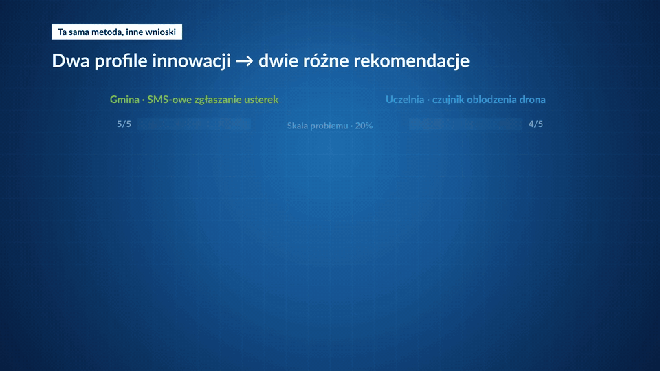
<br>Ta sama metoda, inne wnioski: nowe zgłoszenie gminy trafia na ścieżkę transferu, prototyp z uczelni – na ochronę IP i komercjalizację.
</div>

---

## 📸 Jak to wygląda

### Zgłoszenie innowacji (a) – na żywo
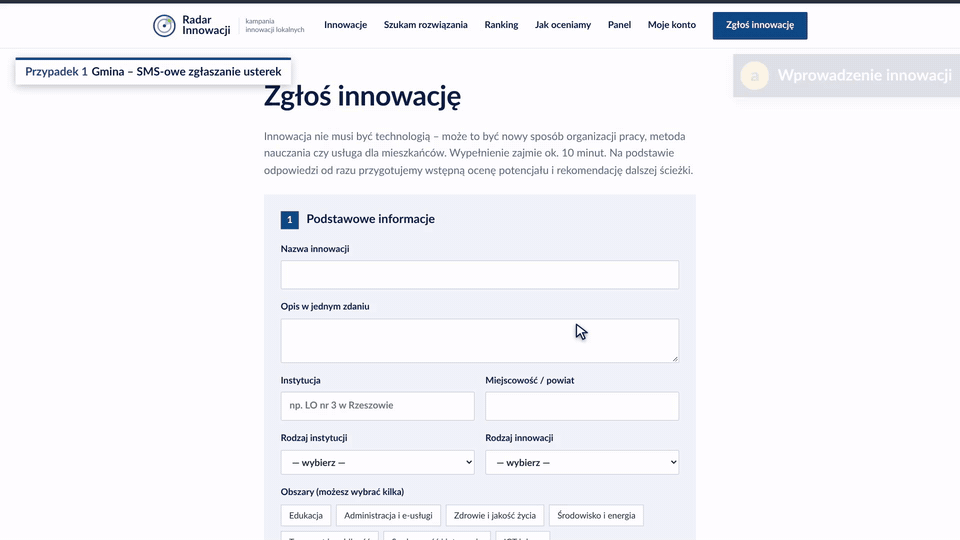

<table>
<tr>
<td width="50%" valign="top">

**🗂️ Karta innowacji (b)**<br>
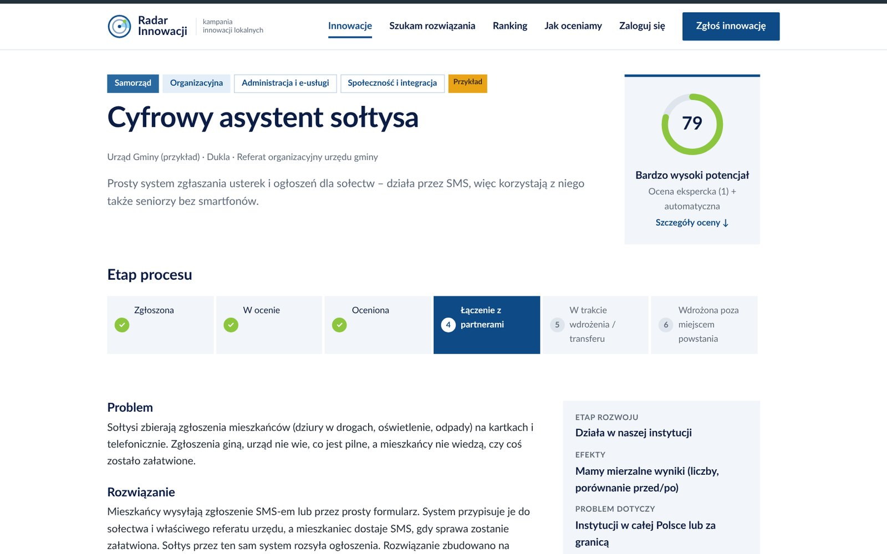

</td>
<td width="50%" valign="top">

**🔍 Podobne innowacje już podczas wpisywania**<br>
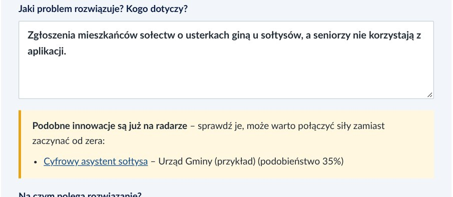

</td>
</tr>
</table>

### 📊 Ocena potencjału według 7 jawnych kryteriów (c)
Każda liczba ma uzasadnienie, a ocena ekspercka zastępuje automatyczną.

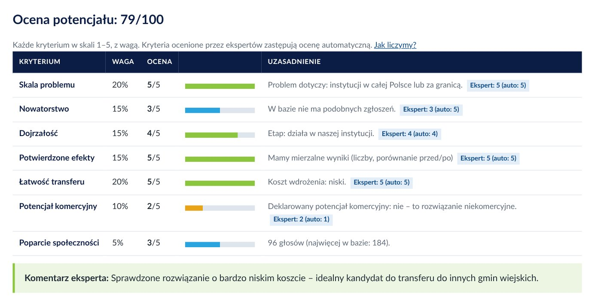

### 🛤️ Rekomendowana ścieżka z krokami i miernikami skuteczności (d, e)

| 🏛️ Gmina – innowacja organizacyjna | 🎓 Uczelnia – technologia (prototyp) |
|---|---|
| 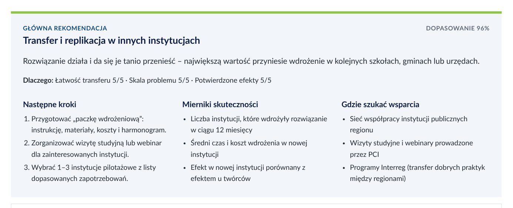 | 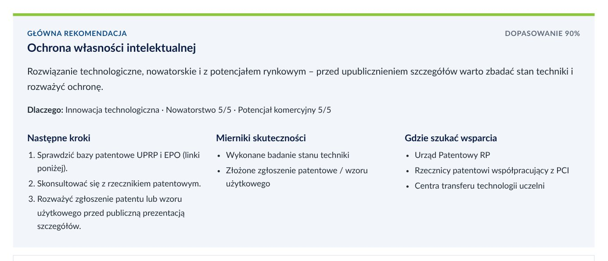 |

### 🤝 Szukam rozwiązania – dopasowanie potrzeb do innowacji
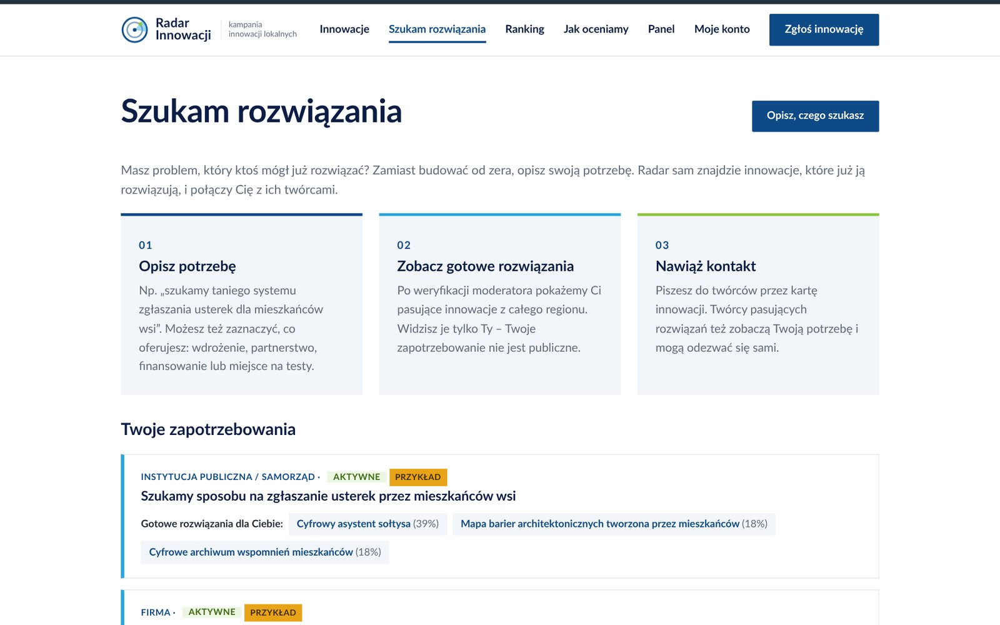

<table>
<tr>
<td width="50%" valign="top">

**📖 Jawna metoda oceny**<br>
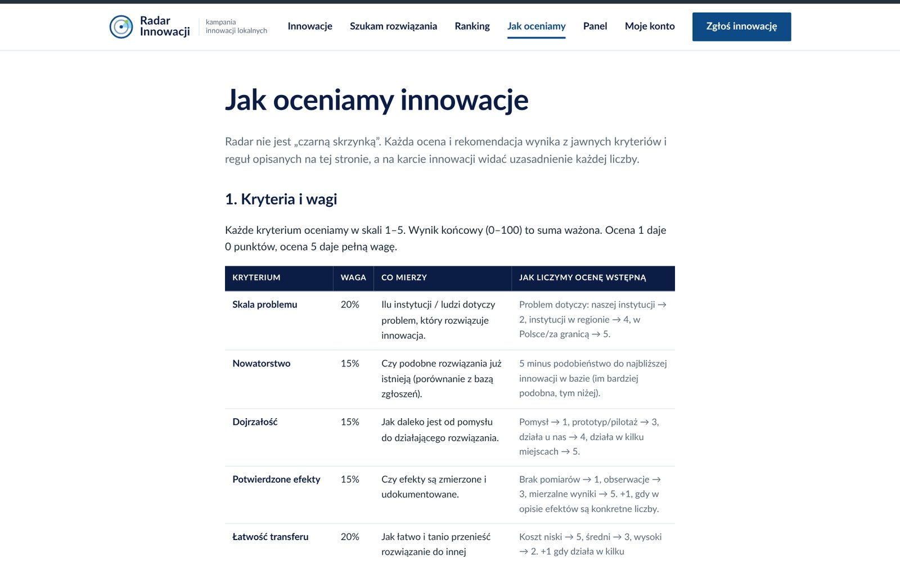

</td>
<td width="50%" valign="top">

**🧑‍⚖️ Panel moderatora**<br>
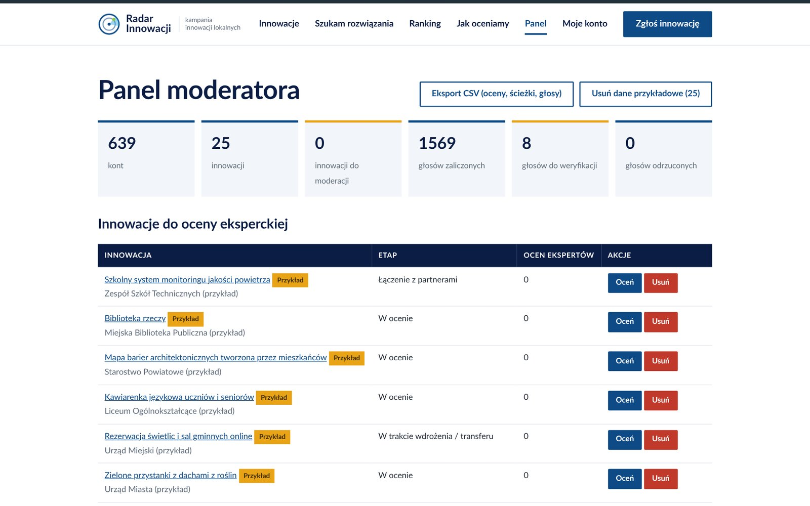

</td>
</tr>
</table>

<details>
<summary><b>✉️ Logowanie bez haseł – tak wygląda mail</b></summary>
<br>
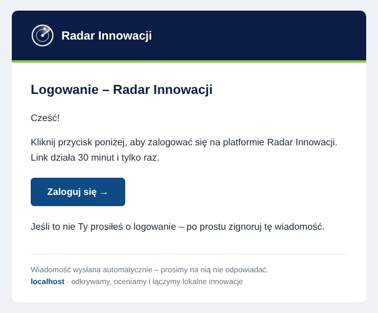
</details>

---

## 📐 Metoda oceny

Każde kryterium oceniane jest w skali 1–5. **Wynik 0–100 to suma ważona**: ocena 1 daje 0 punktów, ocena 5 – pełną wagę kryterium.

| Kryterium | Waga | Co mierzy |
|---|:---:|---|
| Skala problemu | **20%** | Ilu instytucji / ludzi dotyczy problem |
| Łatwość transferu | **20%** | Jak łatwo i tanio przenieść rozwiązanie do innej instytucji |
| Nowatorstwo | 15% | Czy podobne rozwiązania już istnieją (porównanie z bazą zgłoszeń) |
| Dojrzałość | 15% | Od pomysłu do rozwiązania działającego w wielu miejscach |
| Potwierdzone efekty | 15% | Czy efekty są zmierzone i udokumentowane |
| Potencjał komercyjny | 10% | Czy ktoś mógłby za to zapłacić |
| Poparcie społeczne | 5% | Głosy użytkowników (chronione przed botami) |

**Ścieżki rozwoju** – każda ma własną regułę dopasowania liczoną z ocen, a na karcie pokazane jest „dlaczego”:

| Ścieżka | Kiedy wygrywa |
|---|---|
| 🔁 Transfer i replikacja | działa, jest tanie w przeniesieniu i dotyczy wielu instytucji |
| 💼 Komercjalizacja | wysoki potencjał rynkowy i dojrzałość |
| 🧪 Rozwój i pilotaż | obiecujące, ale jeszcze niesprawdzone w praktyce |
| 🛡️ Ochrona własności intelektualnej | technologia, nowatorska, z potencjałem rynkowym – przed publikacją szczegółów |
| 💶 Finansowanie | potrzebne środki na rozwój lub skalowanie |

Pełny opis, źródła danych i ograniczenia: strona **`/jak-oceniamy`** w aplikacji (`templates/method.php`), reguły w `lib/innovation.php`.

---

## 🛡️ Bezpieczeństwo i ochrona głosowania

<details>
<summary><b>Rozwiń szczegóły</b></summary>

- **Logowanie bez haseł** – jednorazowy link e-mail ważny 30 minut (GET pokazuje przycisk, logowanie dopiero po POST – skanery linków w poczcie nie zużyją linku).
- **CSRF**, sprawdzanie nagłówka Origin, restrykcyjny **Content-Security-Policy**.
- **RODO** – adresy IP, podsieci i odciski urządzeń przechowywane wyłącznie jako skróty HMAC.
- **Głosowanie odporne na boty:**
  - proof-of-work liczony w przeglądarce (Web Worker), z jednorazowym, podpisanym wyzwaniem,
  - limity częstotliwości, pułapka honeypot, minimalny czas wypełnienia formularza,
  - blokada jednorazowych skrzynek i normalizacja adresów e-mail,
  - ocena ryzyka głosu – podejrzane głosy są **wstrzymywane do weryfikacji**, a moderator zatwierdza lub odrzuca całe grupy (np. „farmę” kont z jednego urządzenia).
- **Zapotrzebowania są prywatne** – widzi je tylko autor, moderator i twórcy pasujących innowacji.

</details>

---

## 🏗️ Architektura

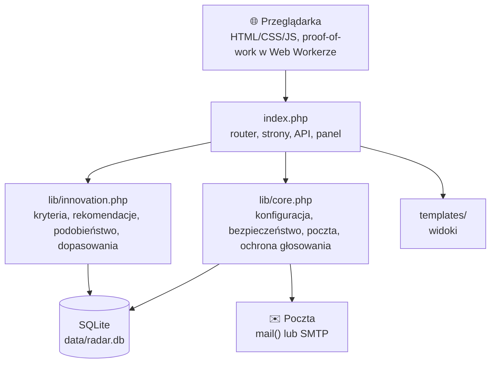

**Technologie:** PHP 8.1+ · SQLite (PDO) · czysty HTML/CSS/JS (bez frameworków) · działa na **zwykłym hostingu współdzielonym** – bez serwerów aplikacyjnych, Dockera i kosztów chmury. Wersja na żywo działa na hostingu nazwa.pl.

---

## 🚀 Uruchomienie lokalne (ok. 5 minut)

Projekt nie wymaga bazy danych na serwerze, Node.js, Dockera ani Composera. Wystarczy **PHP 8.1 lub nowszy** z rozszerzeniami `pdo_sqlite` i `mbstring` (zwykle są w standardowej instalacji).

### Krok 1. Pobierz kod
- Przez Git:
  ```
  git clone <adres-tego-repozytorium>
  cd <nazwa-repozytorium>/radar-innowacji-repo
  ```
- albo na GitHubie: **Code → Download ZIP**, rozpakuj i otwórz folder **`radar-innowacji-repo`**.

> [!IMPORTANT]
> Kod aplikacji jest w folderze **`radar-innowacji-repo`** – wszystkie poniższe polecenia uruchamiaj właśnie w nim.

### Krok 2. Sprawdź, czy masz PHP
W terminalu (Windows: *PowerShell* lub *Wiersz polecenia*) wpisz:
```
php -v
```
Jeśli widzisz `PHP 8.1` lub nowszy, przejdź do kroku 3. W przeciwnym razie zainstaluj PHP:

| System | Instalacja |
|---|---|
| **Windows** | Najprościej: `winget install PHP.PHP.8.3` w PowerShellu, potem **zamknij i otwórz terminal ponownie**. Alternatywnie: pobierz „VS17 x64 Non Thread Safe” Zip z https://windows.php.net/download, rozpakuj do `C:\php` i dodaj `C:\php` do zmiennej środowiskowej PATH. |
| **macOS** | `brew install php` (wymaga Homebrew: https://brew.sh) |
| **Linux (Ubuntu/Debian)** | `sudo apt install php-cli php-sqlite3 php-mbstring` |

### Krok 3. Uruchom
**Windows:** kliknij dwukrotnie plik **`start.bat`** w folderze `radar-innowacji-repo`
(albo w terminalu w tym folderze: `.\start.bat`).

**macOS / Linux:** w terminalu w folderze `radar-innowacji-repo`:
```
sh start.sh
```

Skrypt automatycznie:
1. sprawdza wersję PHP i wymagane rozszerzenia (na Windows w razie potrzeby włącza je tylko dla tego uruchomienia),
2. tworzy plik konfiguracyjny `.env` z losowymi kluczami w **trybie lokalnym**,
3. tworzy bazę SQLite w `data/`, konto administratora `admin@example.com` i wczytuje **dane przykładowe** (25 innowacji, zapotrzebowania, głosy, oceny eksperckie, kontakty),
4. uruchamia serwer i otwiera przeglądarkę na **http://localhost:8000**.

Serwer zatrzymasz w terminalu skrótem **Ctrl+C**. Kolejne uruchomienia niczego nie nadpisują.

<details>
<summary>Uruchomienie ręczne (bez skryptów)</summary>

```
php setup.php
php -S localhost:8000 dev-router.php
```
Inny port: `php setup.php --port=8080` i `php -S localhost:8080 dev-router.php`. Bez danych przykładowych: `php setup.php --bez-demo`.
</details>

### Krok 4. Zaloguj się jako administrator
1. Kliknij **Zaloguj się**, wpisz `admin@example.com` i kliknij **Wyślij link logowania** (jeśli klikniesz bardzo szybko, przycisk pokaże „Chwileczkę…” – to zabezpieczenie przed botami, formularz wyśle się sam po ok. 3 s).
2. W trybie lokalnym nie jest potrzebna poczta – **link logowania pojawi się od razu na stronie**. Kliknij go, a potem **Zaloguj mnie**.
3. W menu pojawi się **Panel** (moderacja, oceny eksperckie, weryfikacja głosów, eksport CSV).

> [!TIP]
> Aby zobaczyć platformę oczami zwykłego użytkownika, zaloguj się w drugiej przeglądarce (lub oknie prywatnym) dowolnym innym adresem, np. `gmina@example.org`.

<details>
<summary><b>🔧 Rozwiązywanie problemów</b></summary>

| Problem | Rozwiązanie |
|---|---|
| `php` nie jest rozpoznawany | PHP nie jest w zmiennej PATH. Po instalacji zamknij i otwórz terminal ponownie. |
| `Brak rozszerzeń PHP: pdo_sqlite, mbstring` | Windows: użyj `start.bat` (włącza je automatycznie) albo w pliku `php.ini` (obok `php.exe`; jeśli go nie ma, skopiuj `php.ini-development` jako `php.ini`) usuń średnik przed `extension=pdo_sqlite` i `extension=mbstring`. Linux: `sudo apt install php-sqlite3 php-mbstring`. |
| `Address already in use` / port zajęty | Uruchom na innym porcie: `start.bat 8080` lub `sh start.sh 8080`. |
| Strona wyświetla „Brak SECRET_KEY” | Nie utworzono `.env` – uruchom `php setup.php`. |
| Chcę zacząć od zera | Zatrzymaj serwer, usuń plik `data/radar.db` (i ewentualnie `.env`) i uruchom ponownie. |
</details>

---

## 🎯 Scenariusz dla jury (a–e)

1. **Strona główna** – innowacje posortowane według potencjału, z rekomendowaną ścieżką.
2. **Karta „Cyfrowy asystent sołtysa”** – uporządkowane informacje (b), tabela oceny 7 kryteriów z uzasadnieniami (c), rekomendowana ścieżka z krokami, **miernikami skuteczności** i źródłami wsparcia (d, e), podobne innowacje, linki do baz zewnętrznych.
3. **Karta „Inteligentny czujnik oblodzenia skrzydła drona”** – drugi przypadek: innowacja technologiczna, inna ścieżka (ochrona IP, komercjalizacja).
4. **Zgłoś innowację** (a) – podczas wpisywania opisu problemu pojawia się podpowiedź podobnych rozwiązań.
5. **Szukam rozwiązania** – organizacja opisuje potrzebę i dostaje dopasowane innowacje; twórca widzi pasujące potrzeby i może odpowiedzieć.
6. **Jak oceniamy** – jawne kryteria, wagi, reguły rekomendacji, źródła danych i ograniczenia.
7. **Panel** (jako admin) – „Oceń jako ekspert” na dowolnej karcie zmienia ocenę i przelicza rekomendację; sekcja głosów do weryfikacji pokazuje wyłapaną przykładową „farmę” kont.

---

## 🌐 Wdrożenie (hosting z Apache + PHP)
Wgraj zawartość folderu `radar-innowacji-repo` do katalogu domeny i utwórz `.env` na podstawie `.env.example`. Plik `.htaccess` kieruje ruch do `index.php` i blokuje dostęp do `lib/`, `templates/`, `data/` i `.env`. Baza SQLite tworzy się i aktualizuje automatycznie w `data/`.

## 📁 Struktura
```
README.md                  ten opis
docs/                      zrzuty ekranu i animacje do opisu
radar-innowacji-repo/
├── index.php              router, strony, API, panel
├── lib/core.php           konfiguracja, baza, bezpieczeństwo, poczta, ochrona głosowania
├── lib/innovation.php     kryteria oceny, rekomendacje, podobieństwo, dopasowania
├── lib/demo.php           dane demonstracyjne (+ demo_more.php)
├── lib/schema.sql         schemat bazy
├── templates/             widoki
├── static/                CSS, JS (proof-of-work w Web Workerze), fonty, logo do maili
├── setup.php · start.bat · start.sh · dev-router.php
└── .env.example
```

---

## 🧭 Ograniczenia i dalszy rozwój

**Uczciwie o ograniczeniach:**
- Ocena wstępna opiera się na deklaracjach zgłaszającego – dlatego może ją skorygować ekspert.
- Podobieństwo tekstów nie rozumie znaczenia (synonimy) – decyzję podejmuje człowiek.
- Wyszukiwanie w bazach zewnętrznych nie jest jeszcze automatyczne (słowa kluczowe + linki).

**Propozycja rozwoju:**

| Etap | Co | Miernik sukcesu |
|---|---|---|
| 0–3 mies. · **Pilotaż** | 1 region w sieci PCI, szkolenie moderatorów | pierwsze 100 zgłoszeń |
| 3–6 mies. · **Integracje** | automatyczne wyszukiwanie w bazach patentowych i grantowych, powiadomienia o dopasowaniach, panel ekspertów | liczba połączeń innowacja ↔ odbiorca |
| 6–12 mies. · **Skala** | cała Polska, API dla partnerów, raporty dla samorządów | liczba wdrożeń poza miejscem powstania |

<div align="center">
<br>
<a href="https://radarinnowacji.pl"><b>📡 radarinnowacji.pl</b></a> · odkrywamy, oceniamy i łączymy lokalne innowacje
</div>
